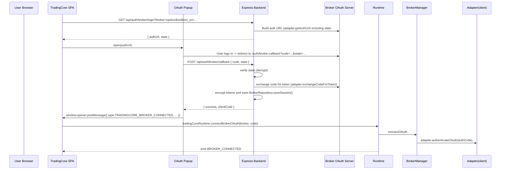
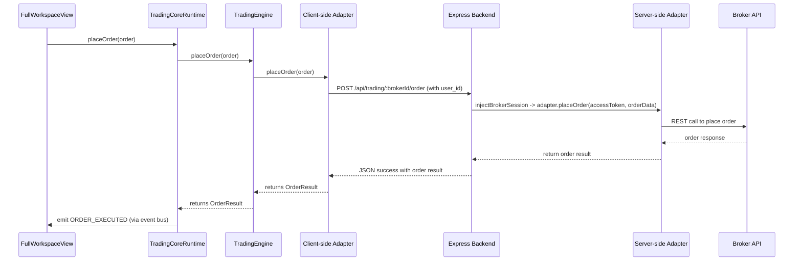
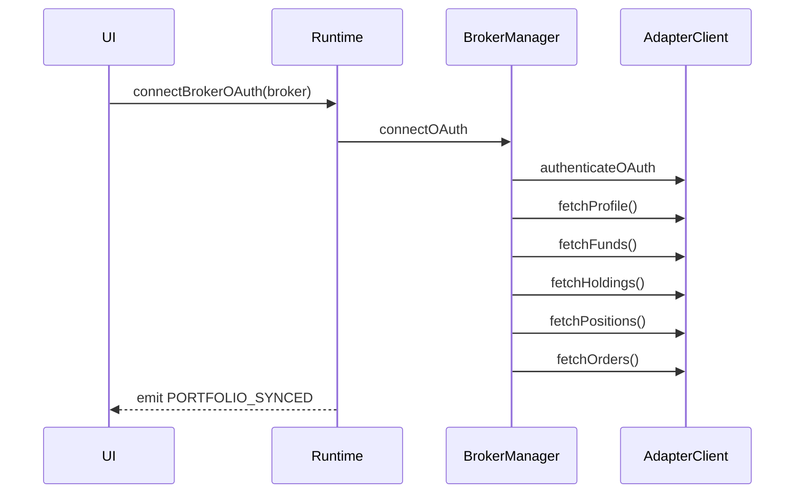
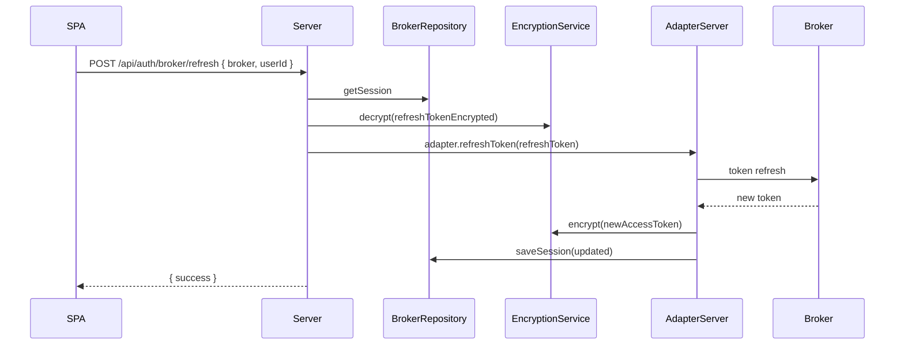

# TRADINGCORE OS — Production Engineering Handoff

> Purpose: Full engineering handoff for a senior engineer to continue development and maintain TradingCore OS. This document reflects the repository state after the latest OAuth infrastructure work.

---

**Contents**
- Executive Summary
- Folder Architecture
- Application Routing
- Pages (detailed)
- Component Inventory (high level)
- Complete OAuth Architecture
- Express Backend Architecture
- Broker Adapter Architecture
- Runtime Architecture
- Authentication Flow
- Database
- Environment Variables
- API Documentation
- Frontend ↔ Backend Communication
- Sequence Diagrams (mermaid)
- Build System
- Production Deployment
- Security Architecture
- Current Progress (Scorecard)
- Remaining Work
- Technical Debt
- File Dependency Graph
- Final Architecture Diagram

---

**Quick repository pointers (key files)**
- Server entry: [server.ts](server.ts#L1)
- Backend routes: [src/server/routes/broker.routes.ts](src/server/routes/broker.routes.ts#L1), [src/server/routes/trading.routes.ts](src/server/routes/trading.routes.ts#L1)
- Server OAuth & encryption: [src/server/auth/OAuthController.ts](src/server/auth/OAuthController.ts#L1), [src/server/auth/OAuthService.ts](src/server/auth/OAuthService.ts#L1), [src/server/encryption/EncryptionService.ts](src/server/encryption/EncryptionService.ts#L1)
- Broker registry/adapters (server): [src/server/brokers/BrokerRegistry.ts](src/server/brokers/BrokerRegistry.ts#L1), [src/server/brokers/adapters/BrokerAdapters.ts](src/server/brokers/adapters/BrokerAdapters.ts#L1), [src/server/brokers/adapters/BaseBroker.ts](src/server/brokers/adapters/BaseBroker.ts#L1)
- Broker session storage (server memory store): [src/server/storage/BrokerRepository.ts](src/server/storage/BrokerRepository.ts#L1)
- Frontend runtime and engine: [src/services/runtime/TradingCoreRuntime.ts](src/services/runtime/TradingCoreRuntime.ts#L1), [src/services/engine/TradingEngine.ts](src/services/engine/TradingEngine.ts#L1)
- Frontend broker adapter layer: [src/services/brokers/BaseBrokerAdapter.ts](src/services/brokers/BaseBrokerAdapter.ts#L1), [src/services/brokers/adapters.ts](src/services/brokers/adapters.ts#L1)
- Frontend OAuth: [src/services/oauth/BrokerOAuthService.ts](src/services/oauth/BrokerOAuthService.ts#L1), [src/services/oauth/PopupManager.ts](src/services/oauth/PopupManager.ts#L1), [src/pages/BrokerCallbackPage.tsx](src/pages/BrokerCallbackPage.tsx#L1)
- Frontend auth (Supabase): [src/services/auth/supabaseClient.ts](src/services/auth/supabaseClient.ts#L1), [src/services/auth/sessionService.ts](src/services/auth/sessionService.ts#L1), [src/services/auth/authService.ts](src/services/auth/authService.ts#L1)
- Frontend UI boot: [src/App.tsx](src/App.tsx#L1)

---

**Legend & assumptions**
- The codebase mixes server-side and client-side TypeScript/TSX in the same repository. Server files are under `src/server/*` and root `server.ts` boots Express + Vite middleware.
- Many broker adapters (server + client) are implemented either as realistic wrappers (Upstox) or as deterministic/mocked token exchanges for demonstration. The repository leans toward a BYOB (Bring Your Own Broker) non-custodial architecture.
- Production broker-token persistence uses the Supabase `broker_sessions` table through the server-side service-role client, with an in-memory Map only as a non-production fallback.

---

**1. Executive Summary**

- What TradingCore OS is
  - TradingCore OS is a browser-hosted trading operating system intended to connect to customer-owned broker accounts (BYOB), provide a non-custodial runtime for order execution, portfolio sync, and market data presentation, and to orchestrate trading strategies via a runtime engine.

- Project goals
  - Provide a secure, non-custodial interface for live trading via multiple brokers.
  - Standardize a unified broker adapter surface (login, profile, funds, holdings, positions, orders, place/modify/cancel orders).
  - Offer a single-page application UX with a workspace, workspace preview, and onboarding (BYOB) flow.
  - Support OAuth-first broker integrations with AES-protected session storage on the server.

- Current production maturity
  - Authentication (user-level) is wired to Supabase in the frontend; OAuth broker flows are implemented end-to-end in code (browser popup → state-authenticated server callback → server token exchange → encrypted session saved in Supabase). However, server session persistence is ephemeral (in-memory) — not production-ready.
  - Broker adapters: Upstox adapter performs real HTTP token exchange (expects credentials in env), others are stubbed/mocked returning deterministic tokens.
  - Runtime: TradingEngine and TradingCoreRuntime provide in-memory routing of orders to adapters and simulated market data.
  - UI: Landing, onboarding, broker connection flow, callback popup, workspace preview, and workspace are implemented as React components and appear production-ready visually.

- Completed phases
  - BYOB UI onboarding & OAuth popup flow
  - Unified broker adapter interfaces and sample adapters
  - AES-256-GCM encryption utilities for server-side token encryption
  - Runtime skeleton (TradingEngine, BrokerManager, TradingCoreRuntime)
  - Express API endpoints for broker auth and trading proxy endpoints
  - Supabase authentication wiring on frontend

- Pending phases
  - Persistent server-side token storage (database-backed) with secure key management
  - Production secrets management and rotating encryption keys
  - Full, tested broker adapters for each targeted broker with live REST/WebSocket integration (several adapters are mocked)
  - Full logging, metrics, monitoring, rate-limiting, and error reporting
  - WebSocket & real-time tick ingestion in production
  - Compliance testing and security hardening for production

- Architecture philosophy
  - BYOB, non-custodial first: users connect their broker accounts and TradingCore routes orders directly — TradingCore does not custody funds.
  - Minimal trusted surface: encryption and token handling occur server-side; the browser receives only session signals and interacts through the runtime layer.
  - Adapter pattern: uniform broker interface with per-broker adapters (server and client sides) to allow common runtime & UI.
  - Frontend-first single-page application with server providing secure endpoints for OAuth token exchange and broker-proxied operations.

**What's Built (Implemented components)**

The following features and components are implemented in the repository today. Each item below includes one or more source file pointers for quick inspection.

- **Frontend single-page application (SPA)** — React + Vite app and routes: [src/App.tsx](src/App.tsx) and [src/main.tsx](src/main.tsx).
- **User authentication (Supabase)** — frontend Supabase client and session/profile wiring: [src/services/auth/supabaseClient.ts](src/services/auth/supabaseClient.ts), [src/services/auth/sessionService.ts](src/services/auth/sessionService.ts), [src/services/auth/profileService.ts](src/services/auth/profileService.ts), and `AuthContext` ([src/auth/context/AuthContext.tsx](src/auth/context/AuthContext.tsx)).
- **OAuth popup flow (broker onboarding)** — frontend orchestration and popup manager: [src/services/oauth/BrokerOAuthService.ts](src/services/oauth/BrokerOAuthService.ts), [src/services/oauth/PopupManager.ts](src/services/oauth/PopupManager.ts), and callback page [src/pages/BrokerCallbackPage.tsx](src/pages/BrokerCallbackPage.tsx).
- **Server-side OAuth endpoints and controllers** — Express routes and logic for `/api/auth/broker`: [src/server/routes/broker.routes.ts](src/server/routes/broker.routes.ts), [src/server/auth/OAuthController.ts](src/server/auth/OAuthController.ts), [src/server/auth/OAuthService.ts](src/server/auth/OAuthService.ts).
- **Token encryption utilities (AES-256-GCM)** — encrypt/decrypt and CSRF state token helpers: [src/server/encryption/EncryptionService.ts](src/server/encryption/EncryptionService.ts).
- **In-memory broker session store** — session record model and Map-backed store: [src/server/storage/BrokerRepository.ts](src/server/storage/BrokerRepository.ts).
- **Server-side broker registry & adapters** — adapter pattern and Upstox token exchange implementation (other adapters present as stubs): [src/server/brokers/BrokerRegistry.ts](src/server/brokers/BrokerRegistry.ts), [src/server/brokers/adapters/BaseBroker.ts](src/server/brokers/adapters/BaseBroker.ts), [src/server/brokers/adapters/BrokerAdapters.ts](src/server/brokers/adapters/BrokerAdapters.ts).
- **Trading proxy API** — server trading routes that decrypt session and call adapter methods: [src/server/routes/trading.routes.ts](src/server/routes/trading.routes.ts).
- **Client-side broker adapter layer** — `BaseBrokerAdapter` and concrete client adapters that call `/api/trading/*`: [src/services/brokers/BaseBrokerAdapter.ts](src/services/brokers/BaseBrokerAdapter.ts), [src/services/brokers/adapters.ts](src/services/brokers/adapters.ts), [src/services/brokers/BrokerAdapter.ts](src/services/brokers/BrokerAdapter.ts).
- **Runtime, engine, and broker manager (frontend)** — orchestration, order routing, and connection management singletons: [src/services/runtime/TradingCoreRuntime.ts](src/services/runtime/TradingCoreRuntime.ts), [src/services/engine/TradingEngine.ts](src/services/engine/TradingEngine.ts), [src/services/brokers/BrokerManager.ts](src/services/brokers/BrokerManager.ts).
- **Workspace UI and components** — main workspace screens and components: [src/components/workspace/FullWorkspaceView.tsx](src/components/workspace/FullWorkspaceView.tsx), [src/components/workspace/WorkspacePreview.tsx](src/components/workspace/WorkspacePreview.tsx), and various UI modules under `src/components/`.
- **Market-data simulator & subscription helpers** — in-client tick simulator and historical data stubs: [src/services/marketData/MarketDataProvider.ts](src/services/marketData/MarketDataProvider.ts) and client adapter simulation in [src/services/brokers/BaseBrokerAdapter.ts](src/services/brokers/BaseBrokerAdapter.ts).
- **Dev & build scripts** — Vite dev integration and build/start scripts in [package.json](package.json) and `server.ts` middleware for development mode.
- **Health endpoint & basic security headers** — server health check and headers: [server.ts](server.ts).

These implemented items are functional at a code level and wired end-to-end for development: OAuth popup flow → server token exchange → encrypted session save (in-memory) → popup postMessage → runtime connect → portfolio sync via client adapters (many adapters return demo/mocked data).

Notes: items marked "implemented" above may still require production hardening (persistence, secrets management, auth middleware, monitoring, tests).

---

**2. Complete Folder Architecture**

Full tree (top-level and notable subfolders):

- [index.html](index.html)
- [LANDING_PAGE_SPECIFICATION.md](LANDING_PAGE_SPECIFICATION.md)
- [metadata.json](metadata.json)
- [package.json](package.json)
- [server.ts](server.ts)
- [api/index.ts](api/index.ts)
- [src/]
  - App.tsx
  - main.tsx
  - vite-env.d.ts
  - auth/
    - components/
      - AuthModal.tsx
      - UserMenu.tsx
    - context/
      - AuthContext.tsx
    - hooks/
      - useAuth.ts
      - useProfile.ts
      - useSession.ts
    - services/
      - index.ts
    - types/
      - index.ts
    - utils/
      - authErrors.ts
  - components/
    - auth/
      - AuthModalPlaceholder.tsx
    - brokers/
      - BrokerSettingsModal.tsx
      - BrokerStrip.tsx
    - common/
      - ErrorCard.tsx
      - LoadingScreen.tsx
    - faq/
      - FAQSection.tsx
    - features/
      - FeaturesDeepDive.tsx
      - WhyTradingCore.tsx
    - footer/
      - Footer.tsx
    - hero/
      - Hero.tsx
    - howItWorks/
      - HowItWorks.tsx
    - navigation/
      - Navbar.tsx
    - pricing/
      - PricingSection.tsx
    - roadmap/
      - FutureModules.tsx
    - workspace/
      - FullWorkspaceView.tsx
      - WorkspacePreview.tsx
  - constants/
    - brokers.ts
    - designSystem.ts
  - pages/
    - BrokerCallbackPage.tsx
    - BrokerConnection.tsx
    - BrokerConnectionRequiredPage.tsx
  - server/
    - auth/
      - OAuthController.ts
      - OAuthService.ts
    - brokers/
      - BrokerRegistry.ts
      - adapters/
        - BaseBroker.ts
        - BrokerAdapters.ts
    - encryption/
      - EncryptionService.ts
    - oauth/
      - BrokerOAuthService.ts
    - routes/
      - broker.routes.ts
      - brokerAuthRouter.ts
      - trading.routes.ts
    - security/
      - EncryptionService.ts (server-side alias)
    - storage/
      - BrokerRepository.ts
  - services/
    - auth/
      - authService.ts
      - profileService.ts
      - sessionService.ts
      - supabaseClient.ts
    - brokers/
      - adapters.ts
      - BaseBrokerAdapter.ts
      - BrokerAdapter.ts
      - BrokerManager.ts
    - engine/
      - TradingEngine.ts
    - marketData/
      - MarketDataProvider.ts
    - oauth/
      - BrokerOAuthService.ts
      - PopupManager.ts
    - runtime/
      - TradingCoreRuntime.ts
  - types/
    - landing.ts
    - navigation.ts

Explain every folder and why it exists (summary):
- src/auth: Frontend authentication UI, hooks, and context. Depends on Supabase client in `src/services/auth`. Used by App to gate views and manage user sessions.
- src/components: All UI components used by landing page, workspace, onboarding, and modals. These are UI-only and depend on services and hooks for behaviour.
- src/constants: Centralized broker metadata and design tokens used across UI and onboarding flows.
- src/pages: SPA route components including OAuth callback page (also used in popup).
- src/server: Express backend code (lightweight) — routes to handle OAuth login/callback/refresh, broker registry, encryption utilities, and in-memory session storage.
- src/services: Cross-cutting client-side services for auth, brokers, runtime, engine, market data, and OAuth Popup orchestration. These implement the runtime and adapter patterns and call backend endpoints where necessary.
- api/: Exposes the Express app for serverless or host integration ([api/index.ts](api/index.ts#L1)).

Dependencies:
- UI depends on services (runtime, auth, broker adapters), which depend on backend endpoints for token exchange and trading operations.
- Server routes depend on BrokerRegistry and EncryptionService to perform token exchanges and secure storage.
- Broker adapters (server-side) depend on environment variables for client IDs/secrets for real brokers (e.g., Upstox).

---

**3. Application Routing (Flow & Code Locations)**

User route flow (high-level):
Landing → Authentication (Supabase Google OAuth) → OS Setup (Broker connection onboarding) → Broker Authentication (OAuth popup or API keys) → Verification (fetch profile/funds/holdings/positions/orders) → Workspace (FullWorkspaceView) → Broker Control Center / Broker settings → Runtime (order placement)

Where transitions occur in code:
- Initial boot & routing guard logic: [src/App.tsx](src/App.tsx#L1) — decides whether to show landing, broker-connection, or workspace based on `useAuth()` and `tradingCoreRuntime.hasConnectedBroker()`.
- Launch platform / navigate: App uses `tradingCoreRuntime` event listeners to switch views: see `tradingCoreRuntime.on('BROKER_CONNECTED'...)` in [src/App.tsx](src/App.tsx#L1).
- OAuth initiation: [BrokerConnectionRequiredPage.tsx](src/pages/BrokerConnectionRequiredPage.tsx#L1) -> `BrokerOAuthService.initiateOAuth()` (calls backend `/api/auth/broker/login`), opens popup via [PopupManager.openPopup](src/services/oauth/PopupManager.ts#L1).
- OAuth callback (popup): [src/pages/BrokerCallbackPage.tsx](src/pages/BrokerCallbackPage.tsx#L1) extracts code & state -> POSTs to `/api/auth/broker/callback` -> on success posts message back to opener window and closes popup.
- PostMessage handling in the main window: [BrokerConnectionRequiredPage.tsx](src/pages/BrokerConnectionRequiredPage.tsx#L1) listens for `TRADINGCORE_BROKER_CONNECTED` and calls `tradingCoreRuntime.connectBrokerOAuth()`.
- Runtime / trading API: Frontend `BaseBrokerAdapter` uses `fetch('/api/trading/:brokerId/*')` endpoints defined in [src/server/routes/trading.routes.ts](src/server/routes/trading.routes.ts#L1) to proxy calls to the server-side broker adapters.

Routing files and responsibilities:
- [server.ts](server.ts#L1): Express boot with Vite dev middleware; mounts `/api/auth/broker` and `/api/trading` routers.
- [src/server/routes/broker.routes.ts](src/server/routes/broker.routes.ts#L1): Defines the unified broker auth API surface.
- [src/server/routes/trading.routes.ts](src/server/routes/trading.routes.ts#L1): Trading proxy endpoints for profile/funds/holdings/positions/orders, and order create/modify/cancel. Injects decrypted access token into request and calls server-side adapter methods.
- [src/pages/BrokerCallbackPage.tsx](src/pages/BrokerCallbackPage.tsx#L1): The OAuth popup UI — performs token exchange via backend after receiving the broker's auth code.

---

**4. Every Page (detailed)**

I list every page and what it does, entrypoint, components used, services used, hooks, runtime dependencies, completion status, and missing items.

- Landing (root view inside [src/App.tsx](src/App.tsx#L1))
  - Purpose: Marketing- and feature-oriented landing page with CTA to launch workspace.
  - Entry point: `AppContent` in [src/App.tsx](src/App.tsx#L1) when `currentView === 'landing'`.
  - Components used: `Navbar`, `Hero`, `WorkspacePreview`, `BrokerStrip`, `WhyTradingCore`, `FeaturesDeepDive`, `HowItWorks`, `PricingSection`, `FutureModules`, `FAQSection`, `Footer`.
  - Services/hooks: `useAuth` for showing sign-in CTA; `tradingCoreRuntime` for Launch behavior.
  - Runtime dependencies: None (read-only); uses `tradingCoreRuntime.hasConnectedBroker()` only to gate launching behavior.
  - Status: Complete UI — production-grade styling present.
  - Missing functionality: None critical for landing; small links and analytics hooks may be missing.

- Authentication Modal / Flows (Supabase)
  - Entry: `AuthModalPlaceholder` and `AuthProvider` in [src/App.tsx](src/App.tsx#L1).
  - Components: `AuthModalPlaceholder`, `AuthModal`, `UserMenu`.
  - Services/hooks: `authService.signInWithGoogle()`, `sessionService` (supabase client), `profileService`.
  - Runtime: Supabase SDK integration handles OAuth redirect & session persistence.
  - Status: Implemented and wired. Needs production environment variables (VITE_SUPABASE_*).
  - Missing: Multi-provider, sign-up flows, 2FA, email flows, and server-side session verification.

- OS Setup / BrokerConnectionRequiredPage
  - File: [src/pages/BrokerConnectionRequiredPage.tsx](src/pages/BrokerConnectionRequiredPage.tsx#L1)
  - Purpose: Onboarding wizard to connect a broker via OAuth or API keys and verify endpoint health.
  - Entry point: when user is authenticated but no connected broker (logic in [src/App.tsx](src/App.tsx#L1)).
  - Components used: UI elements in the file; uses `BROKERS_CONFIG` for list.
  - Services used: `BrokerOAuthService` (frontend), `tradingCoreRuntime.connectBrokerOAuth` and `.connectBrokerApiKeys`.
  - Hooks: `useAuth` for user info.
  - Runtime: Listens for postMessage from popup and then calls runtime to exchange tokens.
  - Status: Implemented with simulated verification checks. Works end-to-end with server callback + encrypted session storage.
  - Missing: Real persistent session storage & robust error handling for all broker types.

- Broker Callback Popup Page
  - File: [src/pages/BrokerCallbackPage.tsx](src/pages/BrokerCallbackPage.tsx#L1)
  - Purpose: Runs inside popup after broker redirects back with auth code; exchanges code with backend and posts message back to opener window.
  - Entry: `window.location` path `/auth/broker-callback` (App renders this directly when pathname matches).
  - Services used: Fetch to `/api/auth/broker/callback`.
  - Hooks: none beyond local state.
  - Runtime dependencies: Must be opened with correct redirectUri registered in broker developer console; the page posts message to `window.opener` with `window.location.origin` as target origin.
  - Status: Implemented.
  - Missing: Robust origin checks when posting message (currently uses window.location.origin) and details to handle cross-origin flows if needed.

- Workspace Preview
  - File: [src/components/workspace/WorkspacePreview.tsx](src/components/workspace/WorkspacePreview.tsx#L1)
  - Purpose: Visual preview of the full workspace and CTA to launch.
  - Integrations: Uses `onLaunch` to signal launch; UI-only otherwise.
  - Status: Complete.

- Full Workspace View (Main trading UI)
  - File: [src/components/workspace/FullWorkspaceView.tsx](src/components/workspace/FullWorkspaceView.tsx#L1)
  - Purpose: Primary trading interface after broker connection; shows watchlist, chart area, order entry and positions.
  - Services used: `tradingCoreRuntime` for placing orders and retrieving active broker info.
  - Hooks: internal React state; listens to `tradingCoreRuntime.on('STATUS_CHANGED')`.
  - Runtime dependencies: Relies on `tradingCoreRuntime` delegating to `TradingEngine` and adapters for order execution.
  - Status: UI complete; order placement triggers `tradingCoreRuntime.placeOrder()` which delegates to `TradingEngine` -> active adapter.
  - Missing: Full order lifecycle tracking, confirmations, and real-time market data in production.

- Broker Connection Page (wrapper)
  - File: [src/pages/BrokerConnection.tsx](src/pages/BrokerConnection.tsx#L1)
  - Purpose: Thin wrapper around `BrokerConnectionRequiredPage` used by App; no special logic.

- Additional pages: policy/marketing pages are in components; not separate routes.

---

**5. Component Inventory (selected, exhaustive list would be large)**

I list components with purpose, props, and dependencies for primary components. For brevity I group similar components.

- `Navbar` ([src/components/navigation/Navbar.tsx](src/components/navigation/Navbar.tsx#L1))
  - Purpose: top navigation, triggers auth modal and launch.
  - Props: `onOpenAuthModal`, `onLaunchPlatform`, `onNavigate`, `currentView`.
  - Internal state: none significant.
  - Hooks: none; uses `useAuth` optionally.
  - Reusable: yes (site header)

- `BrokerConnectionRequiredPage` ([src/pages/BrokerConnectionRequiredPage.tsx](src/pages/BrokerConnectionRequiredPage.tsx#L1))
  - Purpose: full onboarding wizard and connection handler.
  - Props: `onBrokerConnected`.
  - Internal state: selectedBroker, authMethod, API key/secret fields, verification checks.
  - Hooks: `useAuth`, `tradingCoreRuntime` events.
  - Reusable: page-specific.

- `BrokerCallbackPage` ([src/pages/BrokerCallbackPage.tsx](src/pages/BrokerCallbackPage.tsx#L1))
  - Purpose: popup token exchange UI.
  - Props: none.
  - Internal state: status, errorMsg, brokerId.
  - Reusable: popup-specific.

- `PopupManager` ([src/services/oauth/PopupManager.ts](src/services/oauth/PopupManager.ts#L1))
  - Purpose: centralizes popup open/close behavior.
  - Methods: `openPopup(url, options)`, `closePopup()`.

- `BrokerOAuthService` (frontend) ([src/services/oauth/BrokerOAuthService.ts](src/services/oauth/BrokerOAuthService.ts#L1))
  - Purpose: hits backend login endpoint to obtain auth URL and opens popup; posts callback to backend on code receipt.
  - Methods: `initiateOAuth(brokerId, customClientId)`, `completeOAuthCallback(brokerId, code, state)`, `verifyEndpoint(brokerId)`.

- `TradingCoreRuntime` ([src/services/runtime/TradingCoreRuntime.ts](src/services/runtime/TradingCoreRuntime.ts#L1))
  - Purpose: Singleton runtime coordinating BrokerManager and TradingEngine; event bus for runtime events.
  - Public API: connect/disconnect brokers, place/modify/cancel orders, sync portfolio, subscribe to ticks, get historical data, event listeners.
  - Dependencies: `brokerManager`, `tradingEngine` instances.

- `TradingEngine` ([src/services/engine/TradingEngine.ts](src/services/engine/TradingEngine.ts#L1))
  - Purpose: universal order execution engine delegating to active adapter.
  - Public API: connect brokers, place/modify/cancel orders, fetch positions/holdings/funds/orders/trades.
  - Dependencies: `BrokerAdapterRegistry`.

- `BaseBrokerAdapter` and concrete adapters ([src/services/brokers/BaseBrokerAdapter.ts](src/services/brokers/BaseBrokerAdapter.ts#L1), [src/services/brokers/adapters.ts](src/services/brokers/adapters.ts#L1))
  - Purpose: provide a consistent client-side adapter API that makes REST calls to server-side trading endpoints and simulates behavior (historical data, market data).
  - Important methods: `authenticateOAuth`, `validateApiKeys`, `fetchProfile`, `getMarketData`, `subscribeWebSocket`, `placeOrder`, `modifyOrder`, `cancelOrder`.

- UI primitives: `LoadingScreen`, `ErrorCard`, `AuthModalPlaceholder`, `BrokerSettingsModal`, `WorkspacePreview`, `FullWorkspaceView`.

Note: each component file contains more complete props and small internal state; review file references above to inspect per-component props and event wiring.


---

**6. Complete OAuth Architecture (end-to-end detail)**

This section explains the entire broker OAuth flow, message exchange, token storage, and verification. All code references are included.

High level sequence (browser popup flow):
1. User clicks "Connect {Broker}" on [BrokerConnectionRequiredPage.tsx](src/pages/BrokerConnectionRequiredPage.tsx#L1).
2. Frontend calls `BrokerOAuthService.initiateOAuth(brokerId, clientId?)` ([src/services/oauth/BrokerOAuthService.ts](src/services/oauth/BrokerOAuthService.ts#L1)).
   - That function performs a GET to `/api/auth/broker/login?broker={broker}&redirect_uri={origin}/auth/broker-callback&client_id={optional}`.
3. Server endpoint: [src/server/routes/broker.routes.ts](src/server/routes/broker.routes.ts#L1) -> `OAuthController.handleLogin` ([src/server/auth/OAuthController.ts](src/server/auth/OAuthController.ts#L1)).
   - `OAuthService.generateAuthUrl()` obtains a server-side Broker adapter via [src/server/brokers/BrokerRegistry.ts](src/server/brokers/BrokerRegistry.ts#L1).
   - `EncryptionService.generateCsrfStateToken()` creates a state token (AES-encrypted payload base64url-encoded) to be sent in the OAuth URL.
   - The server returns `authUrl` and `state` in JSON to the frontend.
4. Frontend receives `authUrl` and opens a popup via `PopupManager.openPopup(authUrl)` ([src/services/oauth/PopupManager.ts](src/services/oauth/PopupManager.ts#L1)).
5. The user authenticates at the broker provider and is redirected to `redirect_uri` (must match the registered callback): typically `/auth/broker-callback?code=...&state=...&broker=upstox`.
6. The popup loads `BrokerCallbackPage` ([src/pages/BrokerCallbackPage.tsx](src/pages/BrokerCallbackPage.ts#L1)) because the SPA route renders it when pathname matches.
7. `BrokerCallbackPage` extracts `code`, `state`, and `broker` query params and immediately POSTs them to `/api/auth/broker/callback` with body { broker, code, state, redirectUri }.
8. Server accepts POST at [OAuthController.handleCallback](src/server/auth/OAuthController.ts#L1), which calls `OAuthService.handleCallback(...)`.
   - `OAuthService.handleCallback` verifies the `state` token by calling `EncryptionService.verifyCsrfStateToken(state)`.
   - Then it retrieves the appropriate server-side adapter from `BrokerRegistry.getAdapter(brokerId)`.
   - Calls adapter.exchangeCodeForToken(code, redirectUri, clientId) to perform the provider token exchange. For Upstox this is a network POST to the broker's token endpoint in [BrokerAdapters.ts](src/server/brokers/adapters/BrokerAdapters.ts#L1). Other adapters may return mocked tokens.
   - On success, the raw tokens (access_token and optional refresh_token) are encrypted using `EncryptionService.encrypt()` (AES-256-GCM). The encryption output is the EncryptedPayload object containing ciphertext, iv, and authTag. The server then constructs a `BrokerSessionRecord` with encrypted payloads, expiry, status: 'Connected', and clientCode.
   - `BrokerRepository.saveSession(session)` stores the session in memory (Map keyed by userId:brokerId).
9. Server responds to popup's POST with success and `clientCode` (or error).
10. The popup page, upon success, posts a window.postMessage to window.opener with payload type `TRADINGCORE_BROKER_CONNECTED`, including broker, code, state, clientCode.
11. Main window receives `TRADINGCORE_BROKER_CONNECTED` in [BrokerConnectionRequiredPage.tsx](src/pages/BrokerConnectionRequiredPage.ts#L1) `window.addEventListener('message', ...)` handler, and calls `tradingCoreRuntime.connectBrokerOAuth(broker, code)`. That method delegates to `brokerManager.connectOAuth(broker, code)`.
12. `brokerManager.connectOAuth` triggers client-side adapter authenticate flow which in many cases simply marks the adapter authenticated and stores local connection metadata (also persists to localStorage), then runtime initiates portfolio sync via adapter fetch endpoints.

Security primitives and implementation details:
- CSRF state token generation: [src/server/encryption/EncryptionService.ts](src/server/encryption/EncryptionService.ts#L1) -> `generateCsrfStateToken(brokerId, userId)` creates a raw JSON object with brokerId, userId, timestamp, and nonce, encrypts it (AES-256-GCM), and base64url encodes the entire EncryptedPayload JSON.
- State verification: `verifyCsrfStateToken` decodes base64url, parses EncryptedPayload, decrypts using master key, checks timestamp within 15 minutes.
- Token encryption: `EncryptionService.encrypt()` performs AES-256-GCM with 12-byte IV, computes authTag, and returns ciphertext/iv/authTag as hex strings. The master key is derived from `ENCRYPTION_SECRET` env var (or default fallback). Master key is created by sha256 of the configured secret string.
- Server storage: `BrokerRepository.saveSession` stores EncryptedPayload objects for accessTokenEncrypted and refreshTokenEncrypted in an in-memory Map. This is ephemeral and must be replaced in production with DB storage and secure key management.

PostMessage, popup closing, verification sequence
- The popup posts a message to `window.opener` with `window.location.origin` as the target. The main window only processes messages from `event.origin === window.location.origin`. After posting, the popup closes itself (setTimeout 1200ms).
- The main onboarding page then sets a visual verification sequence (fetch profile/funds/holdings/positions/orders) that is visually animated and calls `tradingCoreRuntime.connectBrokerOAuth()` which triggers a portfolio sync via `brokerManager.syncPortfolio()`.

Files to inspect for OAuth: see
- Server: [src/server/auth/OAuthController.ts](src/server/auth/OAuthController.ts#L1) and [src/server/auth/OAuthService.ts](src/server/auth/OAuthService.ts#L1)
- Server adapters: [src/server/brokers/adapters/BrokerAdapters.ts](src/server/brokers/adapters/BrokerAdapters.ts#L1)
- Server encryption: [src/server/encryption/EncryptionService.ts](src/server/encryption/EncryptionService.ts#L1)
- Frontend popup: [src/pages/BrokerCallbackPage.tsx](src/pages/BrokerCallbackPage.tsx#L1)
- Frontend popup manager: [src/services/oauth/PopupManager.ts](src/services/oauth/PopupManager.ts#L1)
- Frontend OAuth service: [src/services/oauth/BrokerOAuthService.ts](src/services/oauth/BrokerOAuthService.ts#L1)

Sequence (compact mermaid below) and deeper details in Section 15.

---

**7. Express Backend Architecture**

Files and responsibilities:
- [server.ts](server.ts#L1): boots Express, attaches Vite middleware in development, mounts routers, and exposes `/api/health`.
- [src/server/routes/broker.routes.ts](src/server/routes/broker.routes.ts#L1): unified auth endpoints for brokers: `/login`, `/callback`, `/refresh`, `/sessions`, `DELETE /:id`, `/ :id/verify`.
- [src/server/routes/trading.routes.ts](src/server/routes/trading.routes.ts#L1): trading endpoints proxied for a specific broker ID: profile, funds, holdings, positions, orders, place/modify/cancel order; uses middleware `injectBrokerSession` to pull session from `BrokerRepository` and decrypt `accessTokenEncrypted` via `EncryptionService.decrypt()`.
- [src/server/auth/OAuthController.ts](src/server/auth/OAuthController.ts#L1): high-level controller mapping HTTP requests to `OAuthService` operations.
- [src/server/auth/OAuthService.ts](src/server/auth/OAuthService.ts#L1): logic for generating auth URLs, performing adapter token exchange, encrypting tokens, saving sessions.
- [src/server/encryption/EncryptionService.ts](src/server/encryption/EncryptionService.ts#L1): AES-256-GCM utility and state token utilities.
- [src/server/storage/BrokerRepository.ts](src/server/storage/BrokerRepository.ts#L1): ephemeral in-memory Map storage for BrokerSessionRecord.
- [src/server/brokers/BrokerRegistry.ts](src/server/brokers/BrokerRegistry.ts#L1): initializes server-side adapter instances and returns them via `getAdapter(brokerId)`.
- [src/server/brokers/adapters/BrokerAdapters.ts](src/server/brokers/adapters/BrokerAdapters.ts#L1): concrete adapter implementations for brokers on the server (Upstox performs actual fetch for token exchange; others return mocked tokens).

Middleware patterns:
- Security headers applied in `server.ts` (X-Content-Type-Options, X-Frame-Options, X-XSS-Protection).
- `trading.routes.ts` uses `injectBrokerSession` to ensure a valid broker session is present and to decrypt access token prior to adapter calls.

Session management & lifecycle:
- Sessions are stored by `BrokerRepository` with fields: brokerId, userId, encrypted tokens, expiry, connectedAt, clientCode, status.
- Token refresh is implemented via `OAuthService.refreshSession` which decrypts refresh token and calls adapter.refreshToken(refreshToken).
- There is no persistent DB or user mapping on the server — sessions are keyed by `userId` but `userId` is passed from the frontend (defaults to 'default_user').

Environment variables and direct dependencies (server-side):
- ENCRYPTION_SECRET: used by [EncryptionService.getMasterKey](src/server/encryption/EncryptionService.ts#L1) to derive AES key (sha256).
- UPSTOX_CLIENT_ID, UPSTOX_CLIENT_SECRET: used by Upstox adapter for token exchange in [BrokerAdapters.ts](src/server/brokers/adapters/BrokerAdapters.ts#L1).
- Other broker-specific client IDs are read from env if present (ZERODHA_CLIENT_ID, DHAN_CLIENT_ID, etc.).

Production readiness gaps:
- No persistent storage, no secure rotating key management for ENCRYPTION_SECRET, no DB-backed session storage, lack of authentication/authorization for backend endpoints (anyone can call /api/auth/broker/callback), missing rate limiting, auditing, monitoring.

---

**8. Broker Adapter Architecture**

There are two adapter layers:
- Server-side adapters (under `src/server/brokers/adapters`) that perform OAuth token exchange and call external broker APIs.
- Client-side adapters (under `src/services/brokers/adapters.ts`) that provide a unified API to the UI and call server-side `/api/trading` endpoints.

Server-side adapters (detailed):
- Implement abstract `BaseBroker` ([src/server/brokers/adapters/BaseBroker.ts](src/server/brokers/adapters/BaseBroker.ts#L1)). Key methods:
  - `getAuthUrl(redirectUri, state, clientId)`
  - `exchangeCodeForToken(code, redirectUri, clientId)`
  - `refreshToken(refreshToken)`
  - Optional: per-broker methods to call broker REST endpoints (not fully implemented for all.)

Implemented adapters in repo (server-side):
- Upstox (UpstoxAdapter): does HTTP POST to `https://api.upstox.com/v2/login/authorization/token` for token exchange and refresh. Uses UPSTOX_CLIENT_ID and UPSTOX_CLIENT_SECRET env vars. Implements profile/funds/holdings/positions/orders endpoints via upstoxFetch helper.
- Zerodha: Mocked token exchange; `getAuthUrl` returns Kite URL; exchange returns deterministic mock tokens.
- Dhan: Mock token exchange.
- Angel (angelone): Mock token exchange.
- Fyers: Mock token exchange.
- Groww: Mock token exchange.
- ICICI: Mock token exchange.

Client-side adapters:
- BaseBrokerAdapter and concrete adapters in [src/services/brokers/adapters.ts](src/services/brokers/adapters.ts#L1) mirror broker capabilities and call server endpoints (via fetch to `/api/trading/:brokerId/*`) for profile/funds/holdings/positions/orders and order operations.
- The client-side adapters also simulate WebSocket tick subscription (setInterval generating ticks).

For each broker consider:
- Supported/implemented/pending status:
  - Upstox: Implemented token exchange server-side; client adapter present. REST endpoints used in server adapter (upstoxFetch) — needs live credentials to operate.
  - Zerodha: Client/server mocks exist; needs real token exchange flow (Kite Connect) implemented fully for production.
  - Fyers/Dhan/Angel/Groww/ICICI: Adapters exist as stubs returning mock tokens; need full token exchange flows and REST APIs implemented.

Capabilities (adapter interface) available (see [src/services/brokers/BrokerAdapter.ts](src/services/brokers/BrokerAdapter.ts#L1)):
- Authentication (OAuth & API keys)
- Profile, Funds, Holdings, Positions, Orders fetch
- Place/Modify/Cancel order
- Historical data
- WebSocket subscriptions
- Option chain retrieval
- Logout

Limitations / notes:
- Many adapters return mocked data; Upstox is the only adapter performing real HTTP token exchange.
- Server-side adapters do not yet implement WebSocket connections to broker streaming endpoints — those are expected to be added per broker.

---

**9. Runtime Architecture**

Key runtime pieces (frontend singletons):
- BrokerAdapterRegistry (client-side): maps adapter IDs to concrete BaseBrokerAdapter instances [src/services/brokers/adapters.ts](src/services/brokers/adapters.ts#L1)
- BrokerManager: manages local connections, primary broker selection, connection persistence (localStorage), portfolio sync, session refresh, connectivity tests [src/services/brokers/BrokerManager.ts](src/services/brokers/BrokerManager.ts#L1)
- TradingEngine: universal execution engine that has activeBrokerAdapter and forwards API calls to it [src/services/engine/TradingEngine.ts](src/services/engine/TradingEngine.ts#L1)
- TradingCoreRuntime: high-level facade & event bus used by UI and orchestrator, and the single exported runtime instance [src/services/runtime/TradingCoreRuntime.ts](src/services/runtime/TradingCoreRuntime.ts#L1)

Flows & responsibilities:
- Connection lifecycle: `BrokerManager.connectOAuth()` or `.connectApiKeys()` updates local `connections` map and persists a simplified representation to localStorage. It updates `primaryBrokerId` and sets metadata like tokenExpiry and permissions.
- Execution lifecycle: UI calls `tradingCoreRuntime.placeOrder(order)` → TradingEngine.placeOrder(order) → activeBrokerAdapter.placeOrder(order) (client-side adapter) → adapter calls server endpoint `/api/trading/:brokerId/order` → server trading route invokes adapter method server-side which makes broker API call (or returns mocked success).
- Market data: `BaseBrokerAdapter.getMarketData()` returns mock data; `subscribeWebSocket()` returns an interval-based ticker simulator. In production this should be replaced by a real WebSocket or data feed.

Singleton architecture: TradingCoreRuntime and TradingEngine use static singleton patterns to ensure single instances across the SPA.

State synchronization:
- BrokerManager persists a shallow snapshot to localStorage for offline continuity.
- BrokerRepository (server) stores sessions in server memory, disconnected from client localStorage — server and client mapping rely on `userId` (default_user) for lookups.

Event bus & listeners: TradingCoreRuntime implements `on(event, listener)` with map of sets for runtime events (BROKER_CONNECTED, ORDER_EXECUTED, TICK_UPDATE, etc.). UI components subscribe to these events.

---

**10. Complete Authentication Flow (User & Broker)**

User auth (frontend):
- Supabase client is configured in [src/services/auth/supabaseClient.ts](src/services/auth/supabaseClient.ts#L1). It reads `VITE_SUPABASE_URL` and `VITE_SUPABASE_ANON_KEY` from `import.meta.env`.
- `authService.signInWithGoogle()` triggers `supabase.auth.signInWithOAuth({ provider: 'google' })`.
- `sessionService` maps Supabase Session to local `Session` type; `AuthContext` uses `sessionService.onAuthStateChange` to subscribe to auth events and initialize profile.
- `profileService.getOrCreateProfile()` queries `profiles` table in Supabase or builds fallback from user metadata.

Broker authentication (frontend → server):
- OAuth flow (described earlier) uses `/api/auth/broker/login` and `/api/auth/broker/callback` server endpoints.
- The server stores tokens encrypted; frontend receives only success messages and clientCode via callback.

Workspace authorization & session refresh:
- Workspace access only requires a connected broker in `tradingCoreRuntime`, which is client-local. The server maintains encrypted sessions but does not authenticate frontend calls to server endpoints — the server trusts `user_id=default_user` URL query param in routes.
- `OAuthService.refreshSession()` can be called via POST `/api/auth/broker/refresh` to refresh tokens server-side.
- Logout: `authService.signOut()` calls Supabase signOut; broker disconnect uses `BrokerRepository.deleteSession()` via `DELETE /api/auth/broker/:id`.

---

**11. Database**

- Frontend uses Supabase for user profiles and authentication: table `profiles` is referenced by [src/services/auth/profileService.ts](src/services/auth/profileService.ts#L1). The code expects fields like `id`, `email`, `name`, `avatar`, `created_at`, `last_login`, `role`, `plan`, `is_onboarded`.
- The server DOES NOT use a database for broker sessions — `BrokerRepository` is an in-memory Map. The server-side table definitions are not present.

Tables referenced:
- `profiles` in Supabase: storing user metadata and last_login. profileService upserts data into this table.

Encryption & lifecycle:
- Broker tokens are encrypted with AES-256-GCM before storage in `BrokerRepository`.
- Lifecycle: sessions expire based on `expiresAt` stored in session record, but there's no automatic eviction logic; refresh endpoint updates `accessTokenEncrypted` and `expiresAt`.

---

**12. Environment Variables (documented usage)**

Frontend env variables (Vite):
- `VITE_SUPABASE_URL`: Supabase project URL — used by [src/services/auth/supabaseClient.ts](src/services/auth/supabaseClient.ts#L1).
- `VITE_SUPABASE_ANON_KEY`: Supabase anon key.

Server / adapter env variables:
- `ENCRYPTION_SECRET` (server): Master key seed used to derive AES-256 key for encryption/decryption in [src/server/encryption/EncryptionService.ts](src/server/encryption/EncryptionService.ts#L1). If absent a default hard-coded string is used — this is insecure in production and must be replaced.
- `UPSTOX_CLIENT_ID`, `UPSTOX_CLIENT_SECRET`: Used by Upstox server adapter in [src/server/brokers/adapters/BrokerAdapters.ts](src/server/brokers/adapters/BrokerAdapters.ts#L1) to perform token exchanges.
- Other optional per-broker client IDs: `ZERODHA_CLIENT_ID`, `DHAN_CLIENT_ID`, `ANGEL_CLIENT_ID`, `FYERS_CLIENT_ID`, `GROWW_CLIENT_ID`, `ICICI_CLIENT_ID`.

Where used:
- ENCRYPTION_SECRET: [src/server/encryption/EncryptionService.ts](src/server/encryption/EncryptionService.ts#L1)
- Broker client secrets: [src/server/brokers/adapters/BrokerAdapters.ts](src/server/brokers/adapters/BrokerAdapters.ts#L1)
- Vite envs: [src/services/auth/supabaseClient.ts](src/services/auth/supabaseClient.ts#L1)

Security note: Environment secrets must be injected via a secure secret store in production and not checked into code. The repository contains fallback defaults which are unsafe for production.

---

**13. API Documentation (backend endpoints)**

Unified Broker Auth API (mounted at `/api/auth/broker` per [server.ts](server.ts#L1) and [broker.routes.ts](src/server/routes/broker.routes.ts#L1)):

- GET `/api/auth/broker/login?broker={broker}&redirect_uri={redirectUri}&client_id={clientId}&user_id={userId}`
  - Purpose: Create broker-specific auth URL and CSRF state token.
  - Input: query params `broker` (id), `redirect_uri`, `client_id` (optional), `user_id` (optional)
  - Output: { success: true, broker, authUrl, state, redirectUri }
  - Implementation: [OAuthController.handleLogin](src/server/auth/OAuthController.ts#L1) -> [OAuthService.generateAuthUrl](src/server/auth/OAuthService.ts#L1)

- POST `/api/auth/broker/callback`
  - Purpose: Accept auth code from popup and perform token exchange, encrypt tokens, and persist session.
  - Input: JSON body { broker, code, state?, redirectUri?, clientId?, userId? }
  - Output: { success: true, broker, expiresAt, connectedAt, clientCode } or error
  - Implementation: [OAuthController.handleCallback](src/server/auth/OAuthController.ts#L1) -> [OAuthService.handleCallback](src/server/auth/OAuthService.ts#L1)

- POST `/api/auth/broker/refresh`
  - Purpose: Refresh access token for broker session using stored refresh token
  - Input: JSON body { broker, brokerId, userId }
  - Output: { success: true } or { success: false, error }
  - Implementation: [OAuthController.handleRefresh](src/server/auth/OAuthController.ts#L1) -> [OAuthService.refreshSession](src/server/auth/OAuthService.ts#L1)

- GET `/api/auth/broker/sessions?user_id={userId}`
  - Purpose: List saved sessions for the user (safe subset of fields)
  - Output: { success: true, sessions: [ { brokerId, clientCode, expiresAt, connectedAt, status } ] }
  - Implementation: [OAuthController.handleGetSessions](src/server/auth/OAuthController.ts#L1) -> `BrokerRepository.getUserSessions`

- DELETE `/api/auth/broker/:id?user_id={userId}`
  - Purpose: Remove a broker session for user
  - Output: { success: boolean, message }
  - Implementation: [OAuthController.handleDisconnect](src/server/auth/OAuthController.ts#L1)

- GET `/api/auth/broker/:id/verify?user_id={userId}`
  - Purpose: Quick verification status for broker session
  - Output: { success: true, broker: id, verified: boolean, checks: { profile, funds, holdings, positions, orders }, latencyMs }
  - Implementation: [OAuthController.handleVerify](src/server/auth/OAuthController.ts#L1) -> [OAuthService.verifyEndpoint](src/server/auth/OAuthService.ts#L1)

Trading API (mounted at `/api/trading` per [server.ts](server.ts#L1)) — path param `:brokerId`:
- GET `/api/trading/:brokerId/profile?user_id={userId}` — returns `adapter.getProfile(accessToken)`
- GET `/api/trading/:brokerId/funds?user_id={userId}` — returns `adapter.getFunds(accessToken)`
- GET `/api/trading/:brokerId/holdings?user_id={userId}` — returns `adapter.getHoldings(accessToken)`
- GET `/api/trading/:brokerId/positions?user_id={userId}` — returns `adapter.getPositions(accessToken)`
- GET `/api/trading/:brokerId/orders?user_id={userId}` — returns `adapter.getOrders(accessToken)`
- POST `/api/trading/:brokerId/order?user_id={userId}` — create order; body is order data -> `adapter.placeOrder(accessToken, body)`
- PUT `/api/trading/:brokerId/order/:orderId?user_id={userId}` — modify order -> `adapter.modifyOrder(accessToken, orderId, body)`
- DELETE `/api/trading/:brokerId/order/:orderId?user_id={userId}` — delete/cancel order -> `adapter.cancelOrder(accessToken, orderId)`

Notes:
- All trading endpoints use `injectBrokerSession` middleware (see [src/server/routes/trading.routes.ts](src/server/routes/trading.routes.ts#L1)) which:
  - Reads session for `brokerId` and `userId` from `BrokerRepository`.
  - Decrypts access token (using `EncryptionService.decrypt`) and attaches `brokerAdapter` and `accessToken` to `req`.
  - If session missing/invalid returns 401.

---

**14. Frontend ↔ Backend Communication**

All REST interactions are via fetch. Major calls and where they happen:

- Frontend -> backend (Auth)
  - GET `/api/auth/broker/login?broker=...` — `BrokerOAuthService.initiateOAuth` ([src/services/oauth/BrokerOAuthService.ts](src/services/oauth/BrokerOAuthService.ts#L1))
  - POST `/api/auth/broker/callback` — both `BrokerCallbackPage` ([src/pages/BrokerCallbackPage.tsx](src/pages/BrokerCallbackPage.tsx#L1)) and `BrokerOAuthService.completeOAuthCallback` use this endpoint.
  - POST `/api/auth/broker/refresh` — `OAuthController.handleRefresh` called by server-side logic or possible client triggers; `BrokerOAuthService` does not call this directly in frontend UI flows.
  - GET `/api/auth/broker/sessions` — `BrokerConnectionRequiredPage` could call this indirectly; `OAuthController.handleGetSessions` returns safe session list.

- Frontend -> backend (Trading)
  - The `BaseBrokerAdapter` implements REST calls to trading endpoints for profile/funds/holdings/positions/orders and order placement/modification/cancellation. See [src/services/brokers/BaseBrokerAdapter.ts](src/services/brokers/BaseBrokerAdapter.ts#L1) which issues `fetch('/api/trading/${this.id}/profile?user_id=default_user')` etc.

- Responses and formats
  - Most server routes respond with JSON { success: boolean, data?: any, error?: string }.
  - Trading routes return `{ success: true, data }` on success; on error they set status code 500 and `{ success: false, error }`.

- PostMessage events
  - OAuth popup -> opener uses `window.opener.postMessage({ type: 'TRADINGCORE_BROKER_CONNECTED', broker, code, state, clientCode }, window.location.origin)` in [src/pages/BrokerCallbackPage.tsx](src/pages/BrokerCallbackPage.tsx#L1).
  - Main window listens on `window.addEventListener('message', ...)` in [BrokerConnectionRequiredPage.tsx](src/pages/BrokerConnectionRequiredPage.tsx#L1) and filters by `event.origin === window.location.origin`.

- Events and callbacks within SPA
  - After successful connection, frontend calls `tradingCoreRuntime.connectBrokerOAuth()` which triggers internal client-side adapters to mark the connection and call `BrokerManager.syncPortfolio()`, which in turn calls client-side adapter methods that fetch the trading endpoints.

---

**15. Sequence Diagrams (mermaid)**

Login / OAuth sequence (popup flow):



Order placement (high-level):



Verification sequence (after connecting broker):



Session refresh (server side):



---

**16. Build System**

- Development: `vite` dev server integrated to Express in `server.ts` (middlewareMode) when `NODE_ENV !== 'production'`. Run scripts are defined in [package.json](package.json).
- Production: `server.ts` serves static files from `dist` directory; building the frontend should emit `dist/index.html` and assets (Vite build).
- `api/index.ts` exports the Express app for serverless platforms (Vercel) or other hosts.
- `tsconfig.json` holds TypeScript config; `vite.config.ts` holds Vite config.

Commands (typical):
- `npm run dev` — starts Vite dev server integrated with Express via `server.ts` (dev middleware)
- `npm run build` — builds the frontend into `dist`
- `npm start` — runs built server in production (NODE_ENV=production) serving static `dist` assets

Environment loading: Vite uses `import.meta.env` for frontend env vars (prefixed with `VITE_`). Server uses `process.env` for secrets.

---

**17. Production Deployment**

Recommendations based on repository:
- Frontend: Build using Vite (`npm run build`) and serve static assets from Express or a static hosting provider (Vercel/Netlify). If using serverless, `api/index.ts` exports the Express app for use in serverless function.
- Backend: Run `server.ts` under Node.js (PM2/systemd) behind a secure reverse proxy. Must configure `ENCRYPTION_SECRET`, broker client IDs/secrets, and VITE_SUPABASE_* variables for frontend build.
- OAuth callback routing: Callback path is `/auth/broker-callback` in SPA. When hosting on static site + serverless, ensure the callback route is resolved to the SPA page and the server `/api/auth/broker/callback` endpoint is reachable from the popup.
- Localhost: For development, `createViteServer` middleware serves SPA and Express runs on same origin (http://localhost:3000) enabling popup `window.opener` origin checks to work.

Deployment checklist (production):
- Replace in-memory `BrokerRepository` with DB-backed store (Postgres/MySQL) and migrate session records.
- Run `ENCRYPTION_SECRET` from an HSM/secret manager and implement key rotation.
- Add authentication and authorization checks on server API endpoints to map Supabase user sessions and verify callers.
- Ensure callback URLs registered with brokers match deployed domain and include HTTPS.
- Harden CORS and postMessage origin checks (support multiple trusted origins if hosting web + mobile).

---

**18. Security Architecture**

- Encryption: Server uses AES-256-GCM for encrypting tokens using a master key derived from `ENCRYPTION_SECRET` via sha256. Implemented in [src/server/encryption/EncryptionService.ts](src/server/encryption/EncryptionService.ts#L1).
  - `encrypt` returns { ciphertext, iv, authTag }.
  - `decrypt` requires correct iv and authTag.
  - `generateCsrfStateToken` encrypts JSON blob and base64url encodes it.

- OAuth state: state tokens are AES-encrypted payloads containing brokerId, userId, timestamp, and nonce. Server verifies timestamp not older than 15 minutes.

- CSRF & postMessage: popup posts message back with `targetOrigin=window.location.origin` and main window validates `event.origin === window.location.origin` before processing. This limits cross-origin injection — but production might require multiple allowed origins.

- Secrets: `ENCRYPTION_SECRET`, broker client ids/secrets must be stored in secure secret management. Current repository has a default ENCRYPTION_SECRET fallback which is insecure.

- Tokens in browser: Access tokens are never sent to the browser. The server stores encrypted tokens and returns only encrypted metadata; the frontend triggers server endpoints which decrypt tokens server-side to call broker APIs.

- CSRF & Cookie: The repo does not currently set HTTP-only cookies or session cookies for mapping user to server sessions — the server relies on user_id query param (default_user) which is insecure. Production must map Supabase authenticated user IDs to server sessions securely.

- Access tokens & refresh tokens lifecycle: Server stores and refreshes tokens via `OAuthService.refreshSession`. There is no refresh scheduler; frontend or a server cron must trigger refresh before expiry.

---

**19. Current Progress — Engineering Scorecard (percent complete estimates)**

- Design System: 85% (UI components and theming present)
- Authentication (Supabase): 90% (frontend integration present, needs backend tie-in)
- Workspace UI: 95%
- Broker Runtime abstraction: 80% (client-side runtime and engine ready; server-side persistence missing)
- OAuth fundamental flow: 90% (end-to-end popup, server token exchange, encryption, and in-memory storage)
- Upstox adapter: 70% (token exchange implemented; REST endpoints used but needs credentials)
- Zerodha: 40% (placeholders/mocks exist)
- Fyers/Dhan/Angel/Groww/ICICI adapters: 30% (stubs)
- Trading Engine (order routing): 70% (flows exist; order lifecycle & confirmations need more robustness)
- WebSockets (live feeds): 30% (simulators in place; real WebSocket integration missing)
- Charts / TradingView integration: 40% (UI simulated; integration not present)
- Options / Greeks / Advanced market features: 20%
- Algorithms / Strategy Builder: 10%
- Portfolio Analytics & Backtesting: 10%

These percentages are coarse and intended to convey relative effort remaining for production hardening.

---

**20. Remaining Work (exact items with pointers)**

High-priority production tasks:
- Replace `BrokerRepository` in-memory store with a database-backed persistence layer (Postgres recommended) and store EncryptedPayloads as JSONB. File: replace [src/server/storage/BrokerRepository.ts](src/server/storage/BrokerRepository.ts#L1).
- Implement server-side user authentication and authorization mapping: authenticate backend API calls using Supabase JWT or session cookie and use Supabase user id to index broker sessions; prevent accepting `user_id` from client query params.
- Move `ENCRYPTION_SECRET` to secure secret manager; remove fallback default in code.
- Add key rotation mechanism and KMS integration; update `EncryptionService` to support key versions and metadata.
- Implement refresh token scheduler or queue to proactively refresh sessions prior to expiry.
- Implement audit logs for token exchange, refresh, and order placement.
- Implement rate-limiting and retry strategies for broker API calls.
- Replace mocked adapters with full, tested adapters for each broker: Zerodha (Kite Connect), Fyers, Dhan, Angel, Groww, ICICI. Each adapter must implement secure token exchange, refresh, REST APIs, and WebSocket feeds.
- Implement production-grade WebSocket ingestion for real-time market data and map to `subscribeWebSocket` of adapters.
- Add strong error handling and end-to-end tests for OAuth flows for each broker.
- Implement real order lifecycle tracking and reconciliation logic (server-side) and ensure idempotency.

Lower-priority / roadmap work:
- TradingView integration or a charting engine with live tick support.
- Options chain, Greeks, and options analytics.
- Strategy builder UI and backtester.
- Replay engine for historical ticks.
- AI-assisted suggestions and risk engine.

---

**21. Technical Debt (explicit list with file references)**

- In-memory session store: [src/server/storage/BrokerRepository.ts](src/server/storage/BrokerRepository.ts#L1) — must be persisted to DB.
- ENCRYPTION_SECRET default in code: [src/server/encryption/EncryptionService.ts](src/server/encryption/EncryptionService.ts#L1) — remove fallback in production.
- Trusting `user_id` query param: trading endpoints use `user_id=default_user` or accept `user_id` from client; insecure — map sessions to authenticated user JWT.
- Mocked adapters: Many server adapters in [src/server/brokers/adapters/BrokerAdapters.ts](src/server/brokers/adapters/BrokerAdapters.ts#L1) return mock tokens — they must be implemented per broker.
- No RBAC or authorization controls on server endpoints — anyone can call `/api/auth/broker/callback` with correct payload.
- No persistent logging, monitoring, or Sentry integration.
- No unit/integration tests included.

Placeholders, TODOs, and stubs:
- `BrokerAdapters.ts` contains several adapters with deterministic token generation for non-Upstox brokers.
- `BaseBrokerAdapter` client-side simulates many behaviors (websocket, historical candles) for demo.

How to productionize each:
- Implement DB-backed session persistence; map Supabase user ID to server sessions using validated JWT from frontend (pass Authorization header with Supabase access token) and validate on server.
- Replace fallback encryption secret and integrate with Cloud KMS/HSM.
- Implement adapter integration test harness and mock broker APIs for CI.

---

**22. File Dependency Graph (high-level)**

App
↓
Pages (Landing, BrokerConnection, BrokerCallback)
↓
Components (WorkspacePreview, FullWorkspaceView, BrokerConnectionRequiredPage)
↓
Hooks/Context (`AuthContext`, `useAuth`, `useProfile`)
↓
Services (frontend): `tradingCoreRuntime`, `tradingEngine`, `BrokerManager`, `BrokerAdapter` client implementations
↓
API calls -> Backend `/api/*`
↓
Server: `broker.routes`, `trading.routes` -> `OAuthService`, `BrokerRegistry`, `EncryptionService` -> `BrokerAdapters` (server)
↓
External: Broker OAuth servers & APIs (Upstox, Zerodha, etc.)

Graphically (mermaid):

```mermaid
flowchart TD
  A[App.tsx SPA] --> B[Pages]
  B --> C[BrokerConnectionRequiredPage]
  B --> D[BrokerCallbackPage]
  C --> E[BrokerOAuthService]
  E --> F[PopupManager]
  E --> G[/api/auth/broker/login]
  D --> H[/api/auth/broker/callback]
  G --> I[OAuthController]
  H --> I
  I --> J[OAuthService]
  J --> K[BrokerRegistry]
  K --> L[Server Adapters]
  L --> M[Broker APIs]
  A --> N[TradingCoreRuntime]
  N --> O[TradingEngine]
  O --> P[BrokerAdapter(client)]
  P --> Q[/api/trading/*]
  Q --> R[trading.routes -> decrypt token]
  R --> S[Server Adapters]
  S --> M

```

---

**23. Final Architecture Diagram**

Mermaid diagram summarizing entire system (frontend, backend, brokers, DB, encryption):

```mermaid
graph LR
  subgraph Browser
    A[SPA (React)]
    A -->|OAuth popup| Popup[Popup Window]
    A --> Runtime[TradingCoreRuntime]
  end

  subgraph Backend
    B[Express App (server.ts)]
    B --> AuthRoutes[/api/auth/broker/*]
    B --> TradingRoutes[/api/trading/*]
    AuthRoutes --> OAuthController[OAuthController]
    TradingRoutes --> TradingController
    OAuthController --> OAuthService
    OAuthService --> BrokerRegistry
    BrokerRegistry --> ServerAdapters[Server Broker Adapters]
    ServerAdapters --> BrokerAPIs[Broker OAuth & REST]
    OAuthService --> EncryptionService[EncryptionService AES-256-GCM]
    OAuthService --> BrokerRepository[BrokerSession DB (in-memory currently)]
  end

  subgraph External
    BrokerAPIs --> Upstox[Upstox API]
    BrokerAPIs --> Zerodha[Zerodha Kite]
    BrokerAPIs --> Angel[Fyers/Angel/Groww/ICICI]
    AuthProvider[Supabase Auth & Profiles] --> A
    AuthProvider --> Backend
  end

  Runtime --> TradingRoutes
  Runtime --> ClientAdapters[Client Adapter Layer]
  ClientAdapters --> TradingRoutes

  note over BrokerRepository,EncryptionService: In production, BrokerRepository -> Persistent DB + KMS for key storage

```

---

Closing notes & next steps for incoming engineer

- Start by replacing the in-memory `BrokerRepository` with a DB-backed store and wire server endpoints to verify Supabase JWT/auth headers (map to internal user_id). Ensure backend endpoints require authorization.
- Rotate `ENCRYPTION_SECRET` out of code into a secrets manager and update `EncryptionService` to support key versioning.
- Implement robust origin allowlist for popup `postMessage` and support dedicated callback domains for hosted deployments.
- Implement test harnesses for adapters: mock broker endpoints and validate the token exchange and refresh flows under error conditions.
- Add server logging, observability, and monitoring (request tracing, Sentry, Prometheus metrics).

If you want, I can:
- Generate a migration plan to replace `BrokerRepository` with a Postgres-backed implementation.
- Draft the server middleware to validate Supabase JWT and map to user sessions.
- Write an integration test suite for Upstox token exchange using recorded HTTP fixtures.

---

Document produced by: GitHub Copilot (GPT-5 mini)
Date: 2026-08-07


